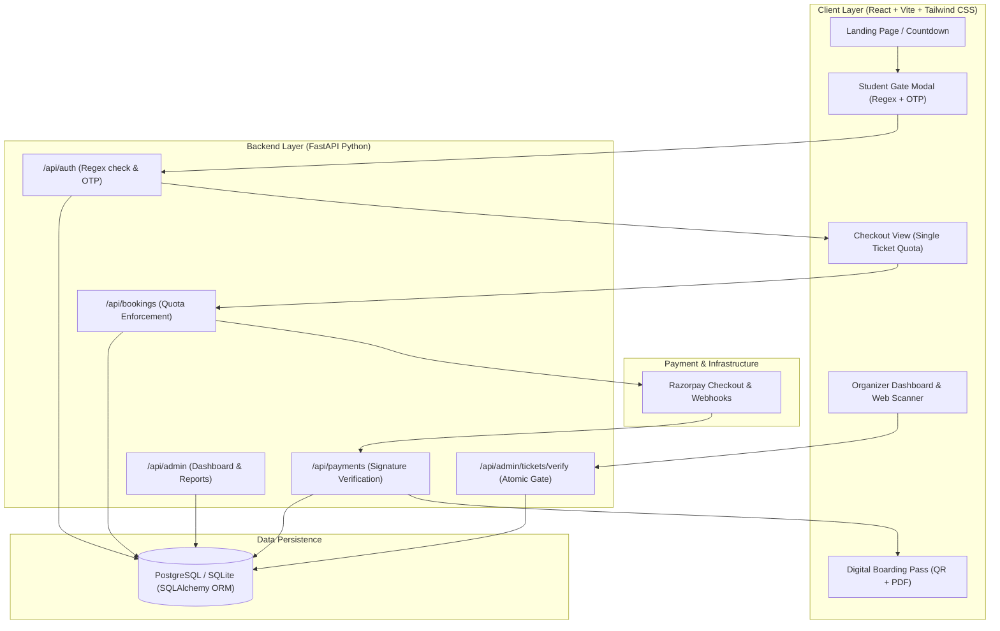
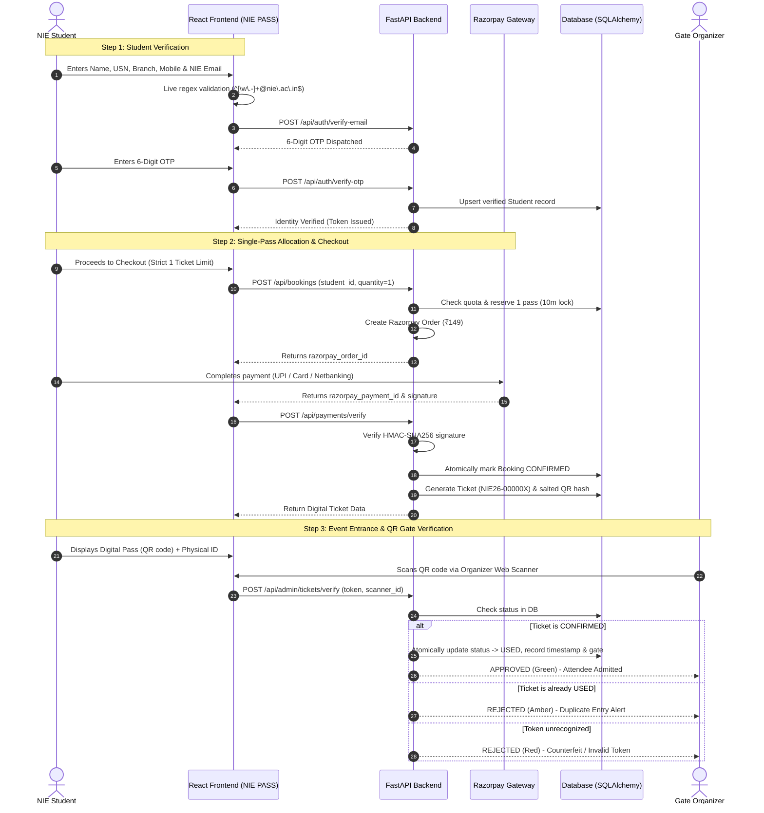
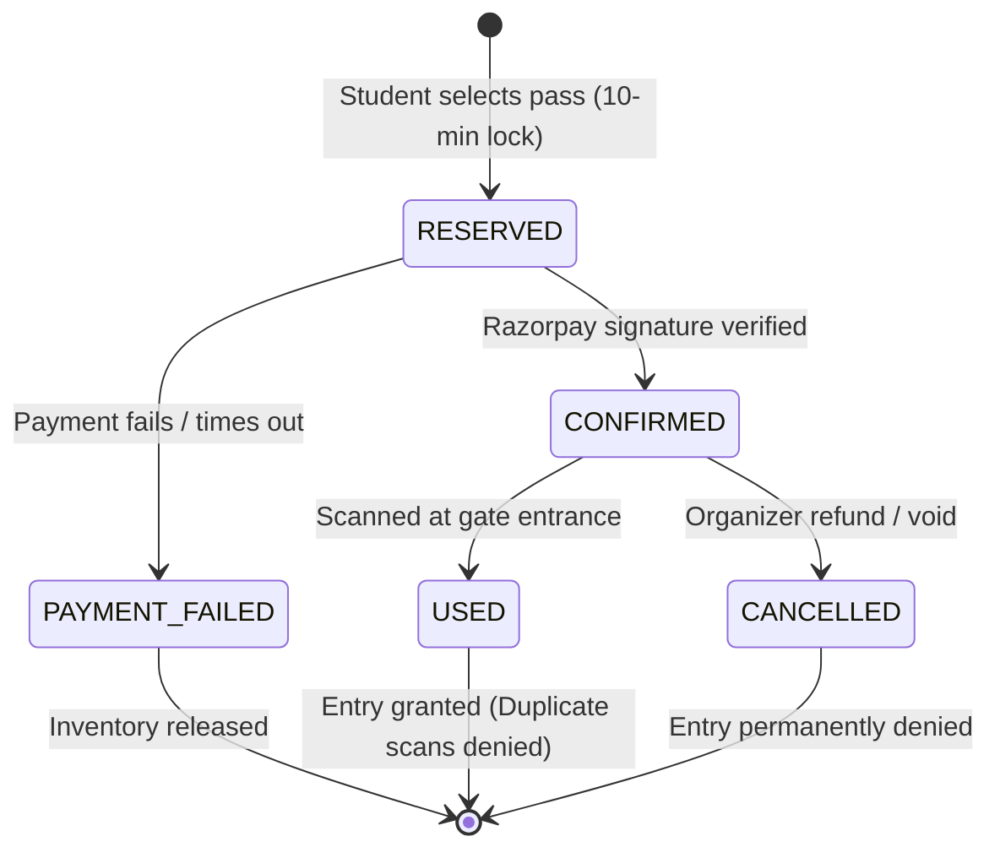
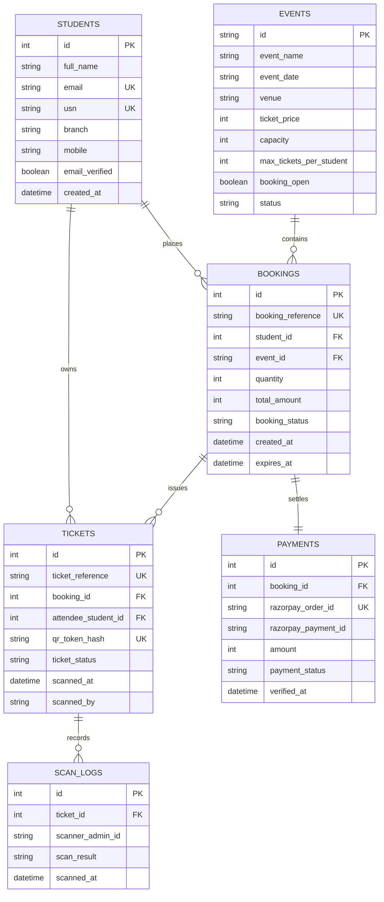

# NIE PASS — Digital Event Ticketing & QR Access Management Platform

> **Project:** NIE Movie Night 2026  
> **Institution:** The National Institute of Engineering (NIE), Mysuru  
> **Host Department:** Information Science & Engineering (ISE) · ArISE Association  
> **Venue:** Diamond Jubilee Complex, South Campus, Mysuru  
> **Date:** 18 November 2026 · Doors open 6:00 PM IST  
> **Platform Version:** 1.0.0 (Full-Stack Production Release)  
> **Motto:** *One Campus. Every Event. One Pass.*

---

## 1. Executive Summary

**NIE PASS** is a high-performance, web-based digital event ticketing and gate access management platform built specifically for **NIE Movie Night 2026**. Taking inspiration from BookMyShow's fluid booking experiences, NIE PASS delivers a modern, dark glassmorphic interface coupled with strict academic access controls, server-verified payments, and tamper-proof QR entrance validation.

### Key Objectives Achieved
1. **Zero Manual Ticketing:** Automated student verification, ticket issuance, and gate scanning.
2. **Hard Single-Ticket Limit (BR-02):** Strict constraint ensuring verified students can only book **exactly one non-transferable pass**.
3. **Strict Academic Email Validation:** Real-time frontend and backend regex enforcement (`^[\w\.-]+@nie\.ac\.in$`).
4. **Server-Side Payment Signature Reconciliation:** Razorpay order generation and HMAC-SHA256 signature verification.
5. **Atomic QR Gate Clearance:** Cryptographic token hashing with atomic status transitions (`CONFIRMED` $\to$ `USED`), permanently preventing duplicate entry or screenshot sharing.
6. **Real-Time Organizer Dashboard:** Live attendance tracking, attendee directory, search/filtering, and CSV export.

---

## 2. System Architecture



---

## 3. End-to-End Booking & Verification Workflow



---

## 4. Ticket Lifecycle State Machine



---

## 5. Entity-Relationship Diagram (Database Design)



---

## 6. Business Rules Matrix

| Rule ID | Name | System Enforcement |
| :--- | :--- | :--- |
| **BR-01** | Student Eligibility | Verified against official institution domain regex `^[\w\.-]+@nie\.ac\.in$`. |
| **BR-02** | Single Ticket Limit | Hardcoded quota of **exactly 1 ticket per student**. Adjustment disabled. |
| **BR-03** | Gate Identification | Digital pass QR verification must be paired with official physical NIE Student ID. |
| **BR-04** | Payment Prerequisite | Digital tickets are generated and persisted only after server-side signature validation. |
| **BR-05** | Cryptographic QR Tokens | QR codes encode high-entropy unpredictable tokens; only salted SHA-256 hashes are stored. |
| **BR-06** | One-Time Use Prevention | Successfully scanned tickets are atomically updated from `CONFIRMED` to `USED`. |
| **BR-07** | Capacity Guard | System automatically locks sales once total confirmed bookings reach 500 tickets. |
| **BR-08** | Invalidation of Failures | Failed or expired payment attempts release reserved inventory and never issue tickets. |
| **BR-09** | Refund Transparency | Strict non-refundable policy displayed prior to order initiation and payment. |
| **BR-10** | Organizer Authorization | Gate scanner and administrative monitoring require authenticated credentials. |
| **BR-11** | Sybil Resistance | Unique constraints on student USN and email prevent multiple booking bypasses. |
| **BR-12** | Complete Audit Trail | All gate scan attempts (successful, duplicate, invalid) are timestamped and logged. |

---

## 7. API Specification (FastAPI Monolith)

### Public Student Endpoints
* `POST /api/auth/verify-email`: Validates institution email regex and dispatches OTP.
* `POST /api/auth/verify-otp`: Confirms 6-digit OTP passcode and upserts student profile.
* `POST /api/bookings`: Reserves 1 student pass and validates event capacity.
* `GET /api/bookings/{booking_reference}`: Retrieves booking state and allocated seat.
* `POST /api/payments/create-order`: Generates Razorpay server order.
* `POST /api/payments/verify`: Validates payment signature and triggers ticket creation.
* `POST /api/webhooks/razorpay`: Authoritative webhook reconciliation listener.

### Organizer & Gate Endpoints
* `GET /api/admin/dashboard`: Live stats (capacity, sold, revenue, checked-in, pending).
* `POST /api/admin/tickets/verify`: Real-time atomic gate verification engine.
* `GET /api/admin/bookings`: Full searchable directory with branch and status filtering.
* `GET /api/admin/reports`: Real-time attendance CSV export.

---

## 8. Installation & Setup

### Prerequisites
* Python 3.10+
* Node.js v18+ & npm

### Backend Setup (FastAPI)
```bash
# Navigate to backend directory
cd backend

# Create virtual environment
python -m venv venv
venv\Scripts\activate      # On Windows
# source venv/bin/activate  # On macOS/Linux

# Install dependencies
pip install -r requirements.txt

# Run server (Swagger docs available at http://localhost:8000/docs)
python run.py
```

### Frontend Setup (React + Vite)
```bash
# Navigate to frontend directory
cd frontend

# Install dependencies
npm install

# Start Vite development server
npm run dev
```

Visit **`http://localhost:5173`** in your browser.

---

## 9. Technology Stack

| Layer | Technology | Purpose |
| :--- | :--- | :--- |
| **Frontend** | React 18 + Vite + TypeScript | High-performance, zero-bloat SPA |
| **Styling** | Tailwind CSS + Lucide Icons | Dark mode glassmorphic BookMyShow aesthetic |
| **Ticketing & QR** | `qrcode.react` + `html2canvas` + `jsPDF` | Vector QR generation and 1-click PDF passes |
| **Backend** | FastAPI (Python) | High-concurrency async REST framework |
| **ORM & Database**| SQLAlchemy + SQLite / PostgreSQL | Atomic state transitions and robust relational schema |
| **Payment Gateway**| Razorpay API + HMAC Verification | Secure order creation and webhook verification |

---

## 10. Department Credits

* **Organizers:** Department of Information Science & Engineering (ISE)
* **Student Association:** ArISE Student Association
* **Venue:** Diamond Jubilee Complex, The National Institute of Engineering, South Campus, Mysuru

*One Campus. Every Event. One Pass.*

